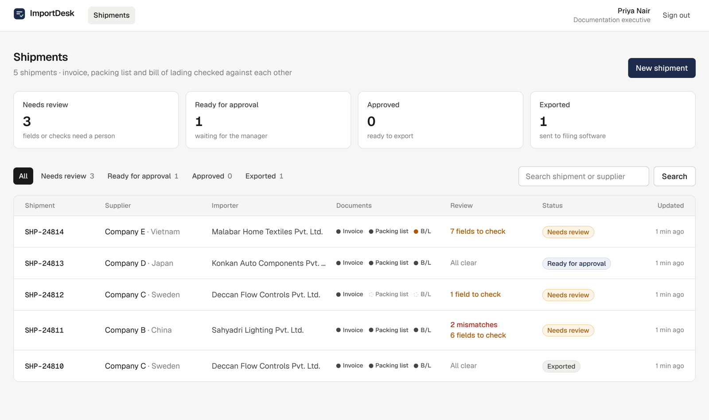
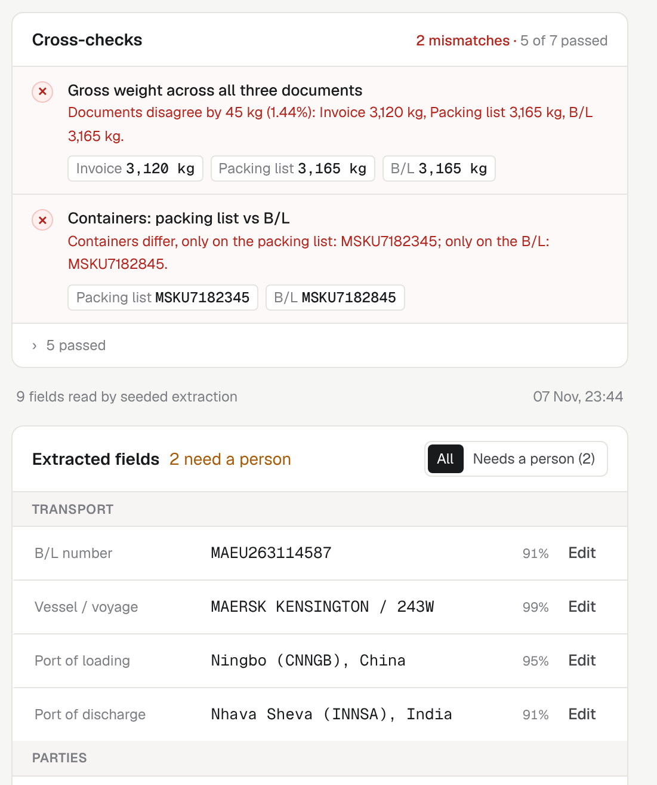
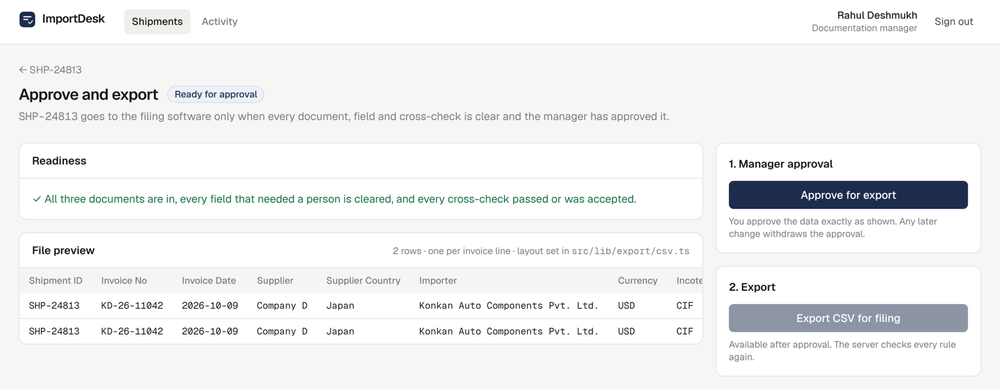
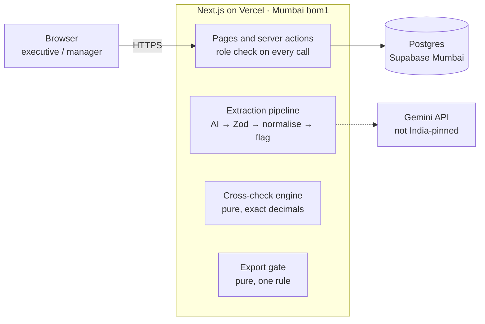

# ImportDesk

**AI document extraction and cross-checks for import shipments.** Built for a customs broker at Nhava Sheva whose documentation team retypes invoices, packing lists and bills of lading into a checklist, then into their filing software.

ImportDesk reads the three documents with a vision AI model, shows every value beside the text it came from, checks the documents against each other, and **blocks export until a person has cleared every uncertain value and every mismatch**.

| | |
|---|---|
| **Live app** | https://YOUR-APP.vercel.app |
| **Executive login** | `executive@importdesk.demo` · `Demo@1234` |
| **Manager login** | `manager@importdesk.demo` · `Demo@1234` |
| **Design document** | Technical Design Document (submitted with this repository) · [decisions log](docs/decisions.md) |

---

## Try it in two minutes

1. Sign in as the **executive** and open **SHP-24811**, the brief's own sample shipment.
2. The cross-checks show two problems: the **gross weight differs by 45 kg (1.44%)** across the documents, and the **container number on the B/L was misread** by one digit.
3. On the **B/L** tab, edit Container 1 to `MSKU7182345`. The check digit is validated, the AI's original value is kept in history, and the container check turns green.
4. Confirm the remaining amber fields, then open **Approval and export**. Export is still blocked by the 45 kg difference.
5. Sign in as the **manager**, accept the difference with a written reason, approve, and export the CSV. The shipment locks.
6. Try **SHP-24814** (an unreadable scan, sent to manual entry), or create a new shipment and upload a PDF from [`samples/`](samples) to run the live AI.

---

## Screenshots

**Shipment list** — counters double as filters; each row shows documents received, fields to check and open mismatches.



**Review panel** — mismatches first with values side by side; uncertain fields highlighted with the reason; one click to confirm. The original document is shown to the left of this panel.



**Approve and export** — a readiness list, a preview of the file, and approval before export.



---

## The problem, in the client's numbers

| Cost (from the brief) | Per year | What ImportDesk does |
|---|---|---|
| Retyping: 1,100 shipments × 45 min × ₹350/h | ₹34.65 lakh | AI pre-fills every field; a person only confirms the uncertain ones |
| Errors forcing an amended Bill of Entry: 396 cases × ₹9,000 | ₹35.64 lakh | Seven cross-checks and a server-enforced export gate |

---

## How it handles the AI being wrong

The rule: **the model suggests, deterministic code checks, a person confirms.**

- Every value carries the model's **confidence**, the **exact text it was read from** and the **page**.
- Answers are validated with a **Zod schema**; an invalid answer gets one retry, then nothing is saved.
- Deterministic checks flag doubtful values: the number must appear in the quoted text, **ISO 6346** container check digits, 8-digit **ITC-HS** codes, **Incoterms 2020**, ISO currencies, real dates, kg conversion, and European vs English number formats (`1.460 kg` on a document that prints `7.650,00`).
- A field needs a person if it is missing, below 85% confidence, flagged, or part of a failed cross-check. Everything else is accepted without a click.
- Corrections keep the AI's original value, which is the raw data for accuracy per field and supplier.
- Unreadable documents go to **manual entry**; failures show **Retry** and **Enter manually**; a document uploaded in the wrong slot is refused.

## Cross-checks

Pure functions with exact decimal arithmetic (`decimal.js`); no database or AI inside.

| Rule | Compares | Blocks export |
|---|---|---|
| Invoice total | Σ (quantity × unit price) vs invoice total | Yes |
| Line amounts | Each printed amount vs quantity × unit price | Yes |
| Quantities | Invoice vs packing list, per unit | Yes |
| Packages | Invoice, packing list and B/L | Yes |
| Gross weight | All three documents, tolerance 0 kg | Yes |
| Containers | Packing list vs B/L | Yes, when listed |
| Invoice reference | Packing list's invoice number vs the invoice | No |

A missing document or value is **never a pass**: it shows as *not checked* and blocks export until it arrives.

## Export gate

One pure function decides the status shown on screen, whether the manager may approve, and whether the server exports. Export needs all three documents, no unconfirmed uncertain field, every blocking check passed or accepted by the manager with a reason, and manager approval of the current version. **It is enforced on the server**: calling the export endpoint directly while anything is open returns `409` with the reasons.

---

## Architecture



| Layer | Choice | Why |
|---|---|---|
| App | Next.js (App Router), TypeScript | One codebase and one deploy for UI, server actions and file routes |
| Database | PostgreSQL on Supabase, Mumbai | Relational data; transactions keep a correction and its re-run checks consistent; India hosting |
| ORM | Prisma 6 (Rust-free client, `pg` adapter) | Typed queries, readable migrations, small serverless bundle |
| AI | Google Gemini, structured JSON output | Reads PDFs and photos directly; model configurable |
| Validation | Zod | Every AI answer and every input parsed before use |
| Styling | Tailwind CSS, own design tokens | Calm, consistent UI for a screen used all day |
| Tests | Vitest | Fast tests for the rules that decide outcomes |

## Security

Bcrypt passwords and a signed httpOnly session · server-side permission checks on every action · uploads identified by file signature · documents served only to signed-in users · audit log of every change and download · per-field optimistic concurrency · security headers · CSV formula-injection protection · secrets only in environment variables · synthetic demo data only.

---

## Run locally

Requirements: Node.js 20+ and a PostgreSQL database (a free Supabase project in the Mumbai region works).

```bash
npm install                 # also generates the Prisma client
cp .env.example .env        # Windows: Copy-Item .env.example .env — then fill in the values
npm run db:deploy           # create the tables
npm run db:seed             # demo users and five sample shipments
npm run dev                 # http://localhost:3000
```

| Script | What it does |
|---|---|
| `npm run dev` | Start the dev server |
| `npm test` | Run the unit tests |
| `npm run db:deploy` | Apply migrations |
| `npm run db:seed` | Reset demo data |
| `npm run db:studio` | Browse the database |
| `npm run samples` | Regenerate the sample PDFs |

**Environment variables** (names only; values live in `.env`, which is never committed): `DATABASE_URL`, `DIRECT_URL`, `SESSION_SECRET`, `GEMINI_API_KEY`, optional `GEMINI_MODEL`. Details in [docs/deployment.md](docs/deployment.md).

## Tests

`npm test` covers the logic that decides outcomes: the cross-check rules (including the brief's 45 kg case), the export gate, AI output validation and normalisation, CSV escaping and injection, file-type detection, permissions and the review rule.

## Project structure

```
src/lib/extraction/   AI call, output schema, validation and normalisation
src/lib/checks/       Cross-check engine (pure) and storage
src/lib/export/       Export gate (pure) and CSV layout
src/lib/fields.ts     What is extracted from each document
src/lib/review.ts     When a field needs a person
src/lib/auth/         Sessions, passwords, role permissions
src/app/              Screens and API routes
prisma/               Schema, migrations, seed and sample documents
docs/                 Decisions log, deployment guide, screenshots
samples/              Synthetic PDFs for trying live upload
```

## Scope, assumptions and limits

- **Built:** the brief's CORE BUILD end to end, plus edit history and an audit log.
- **Not yet built:** the accuracy report screen (the data is captured), highlighting values inside the PDF, and XLSX in the filing software's real layout.
- **Assumptions** (weight tolerance 0 kg, 85% confidence threshold, CSV layout, and others) are labelled in [docs/decisions.md](docs/decisions.md).
- **Limits:** AI accuracy is not yet measured on real shipments; the Gemini call is not hosted in India; seeded shipments are stored as already extracted, while new uploads use the live model.

## How this was built

Built feature by feature with an AI coding assistant, one commit per feature. Design decisions and assumptions were recorded as they were made in [docs/decisions.md](docs/decisions.md).
